# ClaimShield 🛡️

### Know what your health insurer will cut — before they do.
**Insurers use AI agents to adjudicate claims. ClaimShield gives patients the same agents, on their side, before the insurer decides.**

▶️ **Demo video (3 min):** `<paste link>`

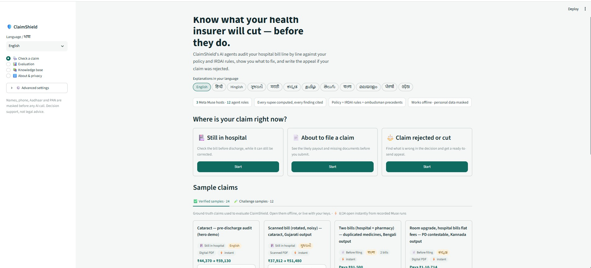

---

## The problem

### In numbers (India, FY 2023-24)
| | |
|---|---|
| **57 crore** | lives covered by health insurance, under 2.68 crore policies |
| **3.26 crore** | health insurance claims filed in one year |
| **₹1.17 lakh crore** | claimed — but only **₹83,493 crore (71%)** paid |
| **₹26,037 crore** | turned down: ₹15,100 cr *disallowed under policy terms* + ₹10,937 cr *repudiated* — **up 19% in a year** |
| **5 in 10** | claimants say their claim was rejected or only partly approved **for invalid reasons** (survey of 1 lakh+ policyholders, 327 districts) |
| **8 in 10** | believe claims are delayed so families give up and accept less |
| **6 in 10** | waited 6–48 hours for hospital discharge while the claim was processed |

### Why it happens
| Cause | What families experience |
|---|---|
| **Policy clauses nobody reads** | Room-rent caps, *proportionate deduction* on doctor and OT fees, sub-limits, co-pays and waiting periods surface only in the settlement letter |
| **"Non-payable" items** | Gloves, kits, food, registration and dozens of other items are cut line by line under IRDAI's standard lists |
| **Bill errors** | Duplicate lines, quantity × rate mistakes, totals that don't match the itemized bill |
| **Missing documents** | Claims are queried or held for one missing report or certificate |
| **Wrongful rejections** | e.g. "pre-existing disease" after the 5-year moratorium, or ignoring portability credit, which families rarely know they can contest |
| **Timing** | All of this is discovered **after discharge**, when the bill can no longer be changed and appeals take months |

### The gap
| Today | Limitation |
|---|---|
| Insurers and TPAs | Use automated adjudication — **for the insurer** |
| Human claim-help services | Slow, paid, mostly after rejection |
| Existing AI tools | Act only **after** a rejection; no line-by-line check of the bill against the policy |

---

## The solution

### One line
ClaimShield audits a hospital bill **line by line against the patient's own policy and IRDAI rules**, predicts every deduction **before** the insurer makes it, tells the family exactly what to fix, and drafts the appeal if the claim is already rejected — in their language.

### Who it is for
| User | Use |
|---|---|
| Patients and families | Check the bill before discharge or submission; contest a rejection |
| Hospital insurance / billing desks | Correct bills before they go to the insurer |
| NGOs, claim helplines, consumer forums | Faster, cited case preparation |

### How it works
| Step | What happens | Powered by |
|---|---|---|
| 1. **Read** | Policy, bills (PDF, scans, phone photos), discharge summary, rejection letter → structured data | Muse vision on Baseten + deterministic parsers |
| 2. **Judge** | A **TPA agent** predicts the insurer's cuts; a **Patient-Advocate agent** challenges each one with tool calls into the policy, the bill and IRDAI rules | Muse API (`muse-spark-1.3`) |
| 3. **Check** | Three Muse hosts vote independently; a critic audits; Python **recomputes every rupee** and keeps only cited findings | Muse API · Baseten · Fireworks + Python |
| 4. **Act** | Action plan, highlighted evidence, appeal and hospital letters, escalation deadlines — in 12 languages | Python + Muse |

### What the family gets
| Output | Example (sample S01, cataract, still admitted) |
|---|---|
| **Verdict** | Insurer will pay **₹44,370 of ₹71,350** as the bill stands |
| **Fixes that add money** | 3 fixes before discharge add **₹14,760**, each with who to ask and what to say |
| **Evidence** | The exact policy clause and the highlighted bill line for every cut |
| **What-if** | Payout waterfall that updates as you choose fixes |
| **Letters** | Appeal to the insurer / bill-correction request to the hospital, PDF in any script |
| **Escalation** | GRO → Bima Bharosa → Insurance Ombudsman → Consumer Commission, with dates as a calendar file |

### Three claim stages
| Stage | Example result |
|---|---|
| 🏥 **Still in hospital** — fix the bill before discharge | Cataract: ₹44,370 → **₹59,130** |
| 📄 **About to file** — likely payout and missing documents | Knee surgery: proportionate deduction is *contestable* when fees don't vary by room |
| ⚖️ **Rejected or short-paid** — find the wrong ground, appeal | Angioplasty rejected for PED after 77 months: **₹2,56,000 recoverable** |

### Why it is different
| | ClaimShield |
|---|---|
| **Prevention first** | Works while the bill can still change, not months after rejection |
| **Adversarial AI** | Insurer-side and patient-side agents argue every cut, and a 3-host jury decides |
| **Exact money** | Every rupee from one deterministic engine; no model-invented amounts |
| **Cited** | Every finding quotes the policy clause or IRDAI rule, verified against the PDF |
| **Inclusive** | 12 Indian languages, voice and phone photos, works offline, personal data masked |
| **Open** | MIT licensed, 36 labelled sample claims, 157 automated tests, published evaluation |

---

## Screenshots
| | |
|---|---|
|  **Home** — language, claim stage, samples | 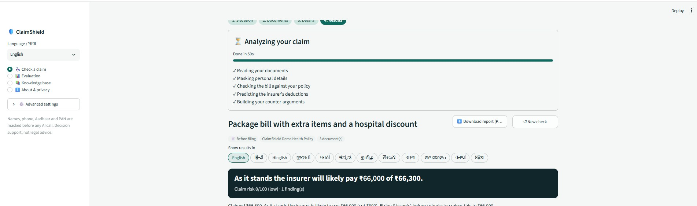 **Live analysis** — agents at work |
| 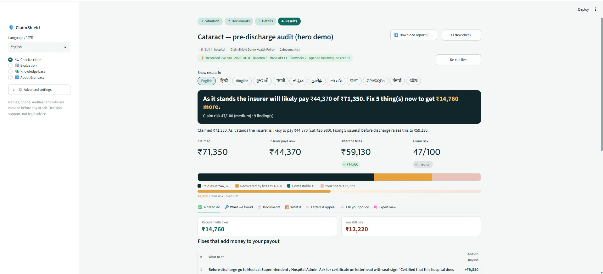 **Results** — verdict, payout now vs after fixes, risk | 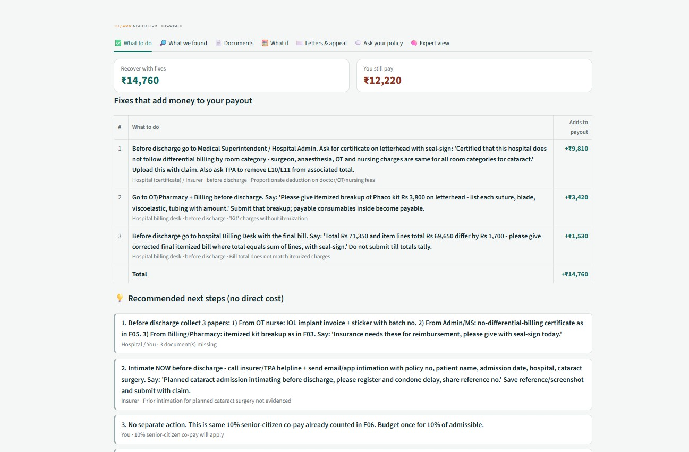 **What to do** — fixes that add money, no-cost steps |
| 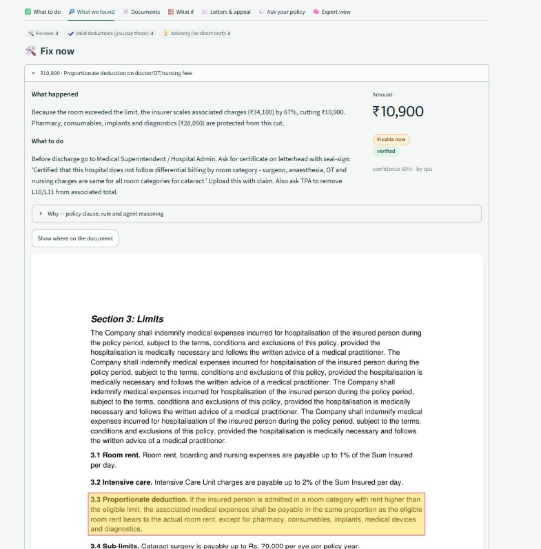 **Findings** — clause + highlighted bill line | 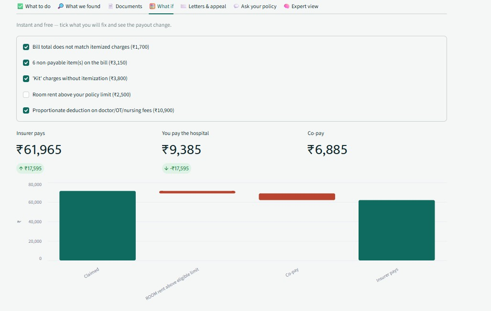 **What if** — payout waterfall |
| 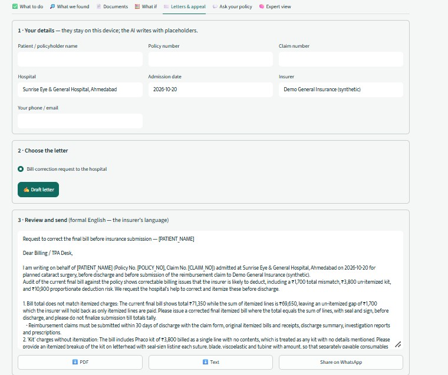 **Letters** — appeal + escalation dates |  **12 languages** — translated in place |
| 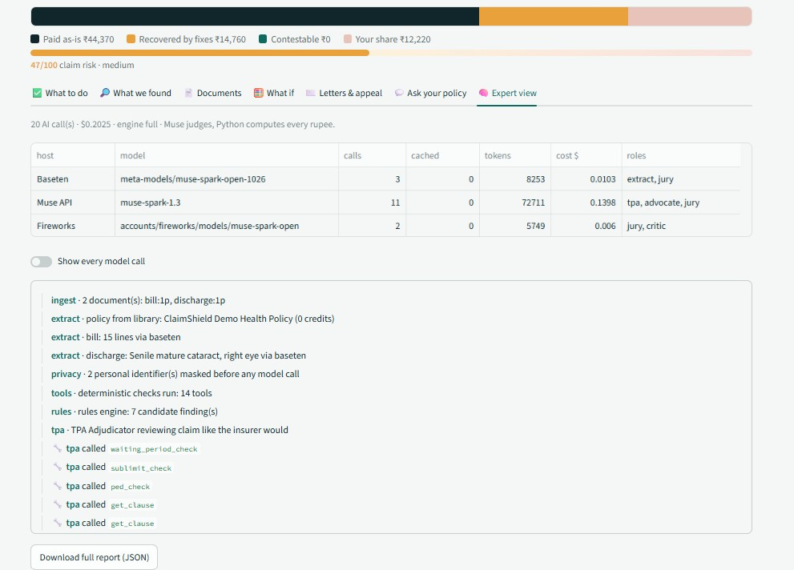 **Expert view** — every model call per host | 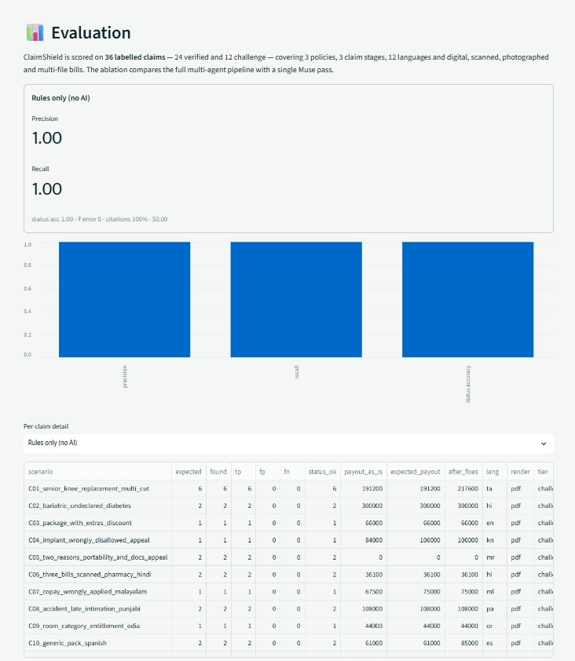 **Evaluation** — 36 labelled claims |
| 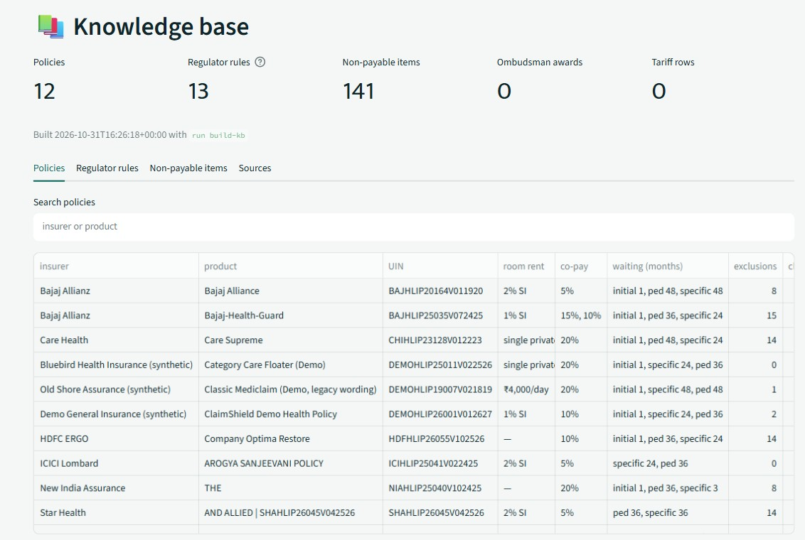 **Knowledge base** — policies, IRDAI rules, sources | |

<sub>**Sources:** IRDAI Annual Report 2023-24 ([Business Standard](https://business-standard.com/industry/news/health-insurers-disallowed-claims-worth-rs-15-100-cr-during-fy24-irdai-124123000562_1.html), [Business Today](https://www.businesstoday.in/personal-finance/insurance/story/health-insurance-claim-rejections-by-insurance-companies-went-up-by-1910-in-fy24-458593-2024-12-26)) · Lok Sabha Unstarred Q. 93, 03.02.2025 ([Sansad](https://eparlib.sansad.in/bitstream/123456789/2989107/1/AU93_3riLi5.pdf), [Moneylife](https://moneylife.in/article/health-insurance-claims-worth-rs2603765-crore-rejected-by-insurers-in-fy2324-govt/76282.html)) · LocalCircles survey, Jun–Dec 2024 ([Moneylife](https://moneylife.in/article/6-in-10-health-insurance-claimants-waited-648-hours-for-claim-approval-and-discharge-from-hospital-localcircles/76013.html), [LocalCircles](https://m-www.localcircles.com/a/press/page/health-insurance-claims-processing)).</sub>

---

## Contents
[Quick start](#quick-start-4-commands) · [How to use](#how-to-use) · [Features](#features) · [Architecture](#architecture) · [Where Muse runs](#where-muse-runs) · [Samples](#sample-claims-36-with-ground-truth) · [Evaluation & tests](#evaluation--tests) · [Knowledge base](#knowledge-base) · [Repository](#repository)

## Quick start (4 commands)
```bash
git clone https://github.com/<you>/claimshield.git
cd claimshield
run setup        # Windows CMD   ·  macOS/Linux:  ./run.sh setup
run app          # opens http://localhost:8501
```
**No API key needed to try it.** Recorded Muse runs of the samples open instantly. Without keys, the deterministic engine audits any digital PDF you upload.

To run the AI agents live, put your keys in `.env` (created by `run setup`), then run `run check`:

| `.env` key | Value |
|---|---|
| `MUSE_BASE_URL`, `MUSE_API_KEY` | Muse API (first-party, `muse-spark-1.3`) |
| `BASETEN_API_KEY` | Baseten (`meta-models/muse-spark-open-1026`) |
| `FIREWORKS_API_KEY` | Fireworks (`accounts/fireworks/models/muse-spark-open`) |
| `PROFILE` | `prod` (default routing) · `dev` (Muse API roles moved to Baseten to save credits) |

<details><summary>All commands</summary>

| `run …` (`./run.sh …`) | Does |
|---|---|
| `setup` | venv + dependencies + `.env` + config check |
| `app` · `offline` · `demo` | App · without AI · replay from cache only ($0) |
| `test` | 157 tests, offline |
| `doctor` · `check` · `models fireworks` | Config check · live provider probe (~$0.003) · list Muse model ids |
| `snapshot [--all]` | Record live runs of the verified samples (instant for everyone after you commit them) |
| `build-kb [--fast] [--discover]` | Fetch + extract the knowledge base from public sources |
| `eval` · `credits` · `samples` | Evaluation and ablation · spend per host · regenerate sample claims |

Docker: `docker build -t claimshield . && docker run -p 8501:8501 --env-file .env claimshield`
</details>

## How to use
| Step | Screen | What you do |
|---|---|---|
| 1 | **Home** | Pick a language chip (one language drives the whole app), then where your claim is: *Still in hospital*, *About to file* or *Claim rejected or cut*. Or open a sample |
| 2 | **Documents** | ① Your policy: pick it from the library, or upload the wording. ② Hospital bill(s): PDFs or phone photos, several files allowed. ③ Discharge summary, plus the rejection letter for appeals |
| 3 | **Details** | Age, policy start date, sum insured, whether the policy was ported. Optional: declared illnesses, documents you have, a note or voice message in any language |
| 4 | **Results** | Verdict, 4 headline numbers, a money bar (paid · recoverable by fixes · contestable · your share), risk gauge, then 7 tabs: **What to do** · **Findings** · **Documents** · **What if** · **Letters** · **Ask your policy** · **Expert view** |
| 5 | **Act** | Tick off the action plan, show the highlighted bill line to the billing desk, download the report PDF in your language, draft the appeal or hospital letter, add the escalation deadlines to your calendar |

## Features
| | |
|---|---|
| **Prevention first** | Checks the bill before discharge or submission, while it can still be corrected |
| **Adversarial agents** | A TPA agent predicts the insurer's cuts and a patient-advocate agent challenges them with tool calls into the policy, the bill and the IRDAI rules |
| **Cross-host jury** | Muse API, Baseten and Fireworks vote independently, in parallel; agreement becomes confidence |
| **Every rupee computed** | One deterministic payout engine; the verifier overrides any model-stated amount and drops uncited claims |
| **Evidence you can show** | Each finding is tied to the exact bill line and policy clause, highlighted on the document |
| **What-if simulator** | Tick the fixes you'll make; the payout waterfall updates instantly (no AI call) |
| **Letters** | Appeal / grievance letter and hospital bill-correction request, written with placeholders; your name and policy number are filled in on your device. Includes a translated copy for the family |
| **Escalation** | Insurer GRO → Bima Bharosa → Insurance Ombudsman → Consumer Commission, with dates as an `.ics` calendar file |
| **12 languages** | English, हिन्दी, Hinglish, ગુજરાતી, मराठी, ಕನ್ನಡ, தமிழ், తెలుగు, বাংলা, മലയാളം, ਪੰਜਾਬੀ, ଓଡ଼ିଆ (+ Spanish for the generic pack). Results translate in place without re-running the audit. PDFs render every script correctly |
| **Any input** | Digital PDFs, rotated scans, phone photos, several bills at once, password-protected PDFs |
| **Ask your policy** | Answers only from your policy's clauses and the IRDAI rules, with citations |
| **Privacy** | Names, phone numbers, Aadhaar, PAN and email are masked before any AI call |
| **Works offline** | Deterministic parsers and rules engine; recorded sample runs open with no keys |
| **Global-ready** | Country packs (`kb/jurisdictions/`): India in depth, US (beta), Generic |

---

## Architecture

### System
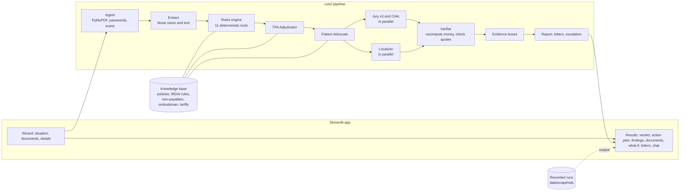

### One claim, end to end
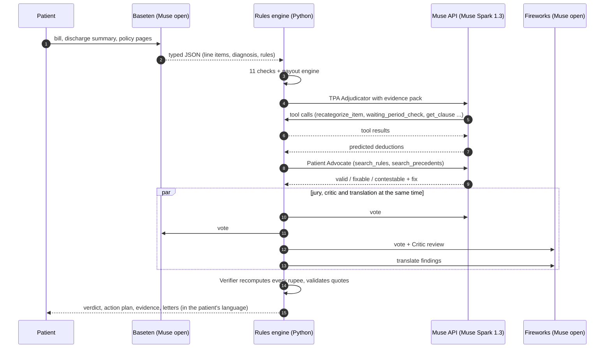

### Reliability: every step has a fallback
| Step | Fallback chain |
|---|---|
| Model call | Next host → JSON schema → JSON → plain + repair → cut-off JSON repair; max 3 requests per host per call |
| Agents | Max 4 tool turns and 75 s per agent, then a final answer; rules engine if no host answers |
| Bill / discharge / rejection | Muse → deterministic parser (digital PDFs) → clear message for scans when offline |
| Policy | Deterministic clause parser **plus** focused Muse passes; only quotes found in the PDF are kept |
| Provider down | Auth/404 disables the host for the session; 3 connection failures trip a circuit breaker |
| Credits | Hard budget per host · content-hash cache · recorded runs · replay mode |

**Muse judges, Python computes.**

## Where Muse runs
| Host | Model | Job | Why |
|---|---|---|---|
| **Muse API** (Meta, first-party) | `muse-spark-1.3` | **The brain**: every judgement that changes what the patient gets | Strongest reasoning and tool calling; ~6–12 calls per claim |
| **Baseten** | `meta-models/muse-spark-open-1026` | **The eyes**: reading bills, scans and policies | High-throughput vision host |
| **Fireworks** | `accounts/fireworks/models/muse-spark-open` | **The independent checker** + translation and chat | Different host from the reasoning agents; fast serverless |

| Role | Primary → failover |
|---|---|
| TPA Adjudicator · Patient Advocate · Appeal writer · Voice | Muse API → Baseten → Fireworks |
| Jury | Muse API + Baseten + Fireworks (one vote each, in parallel) |
| Document extractor · Evidence on scans | Baseten → Fireworks → Muse API |
| Critic · Localizer · Policy chat · Single-pass baseline | Fireworks → Baseten |
| Knowledge-base builder (offline, one time) | Local Llama (Ollama) → Baseten → Fireworks |

Every result shows its calls per host. **Expert view** lists every model call, and the **About** page shows the live routing table. `tests/test_pipeline.py::test_provider_roles_follow_the_map` enforces the map.

---

## Sample claims (36, with ground truth)
| Tier | What it is | Cost to try |
|---|---|---|
| **Verified (24)** | The labelled evaluation set: 3 claim stages, 9 languages, digital/scanned/photo/multi-bill. After the first live run (or `run snapshot`), each opens instantly from `data/snapshots/` | $0 once recorded |
| **Challenge (12)** | New multi-issue cases across 3 policies, 12 languages and 4 input types that the prompts were never tuned on: run them live with your keys | your credits |

<details><summary><b>Verified samples (24)</b></summary>

| ID | Claim | Stage | Output | Input | Issues in ground truth | Result |
|---|---|---|---|---|---|---|
| `S01` | Cataract — pre-discharge audit (hero demo) | Still in hospital | English | Digital PDF | copay, mismatch, missing_doc, non_payable, proportionate, room_rent | ₹44,370 → ₹59,130 |
| `S02` | Hernia — inside 24-month waiting period | Before filing | English | Digital PDF | waiting_period | pays ₹0 |
| `S03` | Appendicitis — missing documents + late intimation | Before filing | English | Digital PDF | intimation, missing_doc | pays ₹72,000 |
| `S04` | Premium IOL cataract — sub-limit exceeded | Before filing | English | Digital PDF | sublimit | pays ₹70,000 |
| `S05` | Dengue — clean claim (control) | Before filing | English | Digital PDF | none (control) | pays ₹48,000 |
| `S06` | Hernia — waiting period served via portability | Before filing | English | Digital PDF | missing_doc, waiting_period | ₹0 → ₹70,500 |
| `S07` | Pneumonia — duplicate & arithmetic billing errors | Before filing | English | Digital PDF | mismatch | pays ₹37,900 |
| `S08` | Angioplasty — PED rejection after moratorium (appeal) | Appeal | English | Digital PDF | missing_doc, wrongful_rejection | ₹2,56,000 recoverable |
| `S09` | Dengue shock — ICU above daily limit | Before filing | English | Digital PDF | icu_rent | pays ₹93,000 |
| `S10` | Cataract package bill — legacy policy sub-limit | Before filing | English | Digital PDF | sublimit | pays ₹40,000 |
| `S11` | Scanned bill (rotated, noisy) — cataract, Gujarati output | Still in hospital | ગુજરાતી | Scanned PDF | copay, mismatch, missing_doc, non_payable, proportionate, room_rent | ₹37,912 → ₹51,480 |
| `S12` | Phone photo of bill (JPG) — kit & non-payables | Before filing | English | Phone photo | missing_doc, non_payable | ₹20,000 → ₹20,900 |
| `S13` | Two bills (hospital + pharmacy) — duplicated medicines, Bengali output | Before filing | বাংলা | 2 bills | mismatch | pays ₹81,500 |
| `S14` | Room upgrade, hospital bills flat fees — PD contestable, Kannada output | Before filing | ಕನ್ನಡ | Digital PDF | proportionate, room_rent | pays ₹1,10,714 |
| `S15` | Knee replacement at 40 months — 48-month clause capped by regulator, Marathi output | Before filing | मराठी | Digital PDF | ped, waiting_period | pays ₹0 |
| `S16` | Typhoid in first 30 days — initial waiting (valid) | Before filing | English | Digital PDF | waiting_period | pays ₹0 |
| `S17` | Road accident on day 10 — waiting waived, FIR/MLC needed | Before filing | English | Digital PDF | missing_doc | pays ₹74,500 |
| `S18` | Rhinoplasty — possible cosmetic exclusion | Before filing | English | Digital PDF | exclusion | pays ₹90,000 |
| `S19` | Diabetic foot — undeclared diabetes, Tamil output | Before filing | தமிழ் | Digital PDF | ped | pays ₹71,000 |
| `S20` | Short-settlement — PD applied to medicines & implants (appeal), Telugu output | Appeal | తెలుగు | Digital PDF | proportionate, room_rent, short_settlement | ₹26,769 recoverable |
| `S21` | Waiting period applied despite portability (appeal), Hinglish output | Appeal | Hinglish | Digital PDF | waiting_period | ₹95,000 recoverable |
| `S22` | Rejected for late intimation (appeal) | Appeal | English | Digital PDF | intimation, wrongful_rejection | ₹71,000 recoverable |
| `S23` | Cashless hernia, senior citizen — only co-pay applies | Before filing | English | Digital PDF | copay | pays ₹60,000 |
| `S24` | Generic (non-India) pack — policy-only checks | Before filing | English | Digital PDF | missing_doc, proportionate, room_rent | ₹49,300 → ₹60,200 |
</details>

<details open><summary><b>Challenge samples (12)</b></summary>

| ID | Claim | Stage | Output | Input | Issues in ground truth | Result |
|---|---|---|---|---|---|---|
| `C01` | Senior knee replacement — room + ICU + PD + non-payables + 20% co-pay | Before filing | தமிழ் | Digital PDF | copay, icu_rent, missing_doc, non_payable, proportionate, room_rent | ₹1,91,200 → ₹2,17,600 |
| `C02` | Bariatric surgery with undeclared diabetes — exclusion + PED risk | Before filing | हिन्दी | Digital PDF | exclusion, ped | pays ₹3,00,000 |
| `C03` | Package bill with extra items and a hospital discount | Before filing | English | Digital PDF | non_payable | pays ₹66,000 |
| `C04` | Implant disallowed as 'consumable' — short-settlement appeal | Appeal | ಕನ್ನಡ | Digital PDF | short_settlement | ₹22,000 recoverable |
| `C05` | Rejected on two grounds — waiting period (ported) + missing reports | Appeal | मराठी | Digital PDF | missing_doc, waiting_period | ₹78,000 recoverable |
| `C06` | Three bills (one scanned) — cross-bill duplicate + arithmetic error, Hindi | Before filing | हिन्दी | 3 bills | mismatch | pays ₹36,100 |
| `C07` | 10% co-pay deducted from a 58-year-old — short-settlement, Malayalam | Appeal | മലയാളം | Digital PDF | short_settlement | ₹7,500 recoverable |
| `C08` | Road accident in week 1 + insurer told after 50 hours, Punjabi | Before filing | ਪੰਜਾਬੀ | Digital PDF | intimation, missing_doc | pays ₹1,08,000 |
| `C09` | Deluxe room on a 'single private AC' policy — no ₹ cap, Odia | Before filing | ଓଡ଼ିଆ | Digital PDF | room_rent | pays ₹44,000 |
| `C10` | Non-India claim on the generic pack — Spanish output | Before filing | Español | Digital PDF | proportionate, room_rent | ₹61,000 → ₹85,000 |
| `C11` | Insurer query letter — documents requested before settlement | Appeal | English | Digital PDF | missing_doc | ₹0 recoverable |
| `C12` | Senior cataract — kit fix doesn't help because the sub-limit caps it, Hinglish | Before filing | Hinglish | Digital PDF | copay, non_payable, sublimit | pays ₹32,000 |
</details>

### Edge cases handled (`data/samples/edge_cases/`, all tested)
| Input | Behaviour |
|---|---|
| Password-protected PDF | Asks for the password (`1234` for the sample); a wrong password gives a clear message |
| Corrupt PDF · non-bill PDF · HEIC photo | Clear message with what to do instead |
| Blank page / unreadable scan offline | Clear message; read by Muse vision when online |
| Rotated bill · 60-line multi-page bill · several bills at once | All lines read; duplicates across files flagged |
| Policy with %-of-SI room limit but no sum insured | Asks for the sum insured, then checks |
| Policy with room *category* entitlement | "Room category above entitlement", with the tariff question to ask |
| Conditional co-pay (zone / network) | Not auto-applied |
| Scanned or schedule-only policy upload | "Policy wording could not be read"; bill checks still run; not cached |
| A host that always cuts answers off | Bounded retries and repair; run completes with correct money |
| Every edge file × 3 policy types × 3 claim stages | Never crashes (`tests/test_robustness.py::test_edge_case_grid`) |

---

## Evaluation & tests
```bash
python eval/run_eval.py --engines rules lean full single --files --max-usd 10     # single = one Muse pass, no tools (ablation)
```
| Engine | Precision | Recall | Status acc. | ₹ error | Citations | Cost |
|---|---|---|---|---|---|---|
| full (TPA + Advocate + Jury + Critic) | 0.86 | 1.00 | 0.92 | ₹0 | 100% | $1.47 (36 claims) |
| lean (Advocate) | 1.00 | 1.00 | 0.88 | ₹0 | 100% | $0.33 (36 claims) |
| single (one Muse pass, ablation) | 1.00 | 0.01 | 0.00 | ₹0 | 0% | $0.02 (36 claims) |
| rules (no AI) | 1.00 | 1.00 | 1.00 | ₹0 | 100% | $0.00 (36 claims) |

`run test` runs 157 tests offline in ~2 minutes:

| File | What it proves |
|---|---|
| `tests/test_ui.py` | All 36 samples driven through the UI (results, evidence, what-if, letters, chat, expert view); language sync; recorded runs open with zero calls; a live run is recorded and then reopens instantly |
| `tests/test_pipeline.py` | Full agent engine on all 36 samples with mock hosts; translation into 12 languages; provider-role map; truncating host never loops; odd model JSON survives |
| `tests/test_robustness.py` | Edge-case grid, regressions, deterministic parsers, JSON repair |
| `tests/test_tools.py` | Payout engine maths, waiting periods, moratorium, PII masking, rules-engine eval |
| `tests/test_identify.py` · `test_fetch.py` · `test_kb.py` | Knowledge base: content-based identification, search, discovery, verbatim quotes |

<!-- MUSE-STUDIES:START -->
### 🔬 Muse studies

Extra evidence beyond the main evaluation. Every number comes from real, uncached Muse calls (`python scripts/muse_studies.py <study>`).

#### 1. Stability — full pipeline, repeated fresh runs
3 independent runs × 36 claims · Muse API $6.02

| Metric | Mean ± spread |
|---|---|
| Precision | 0.84 ± 0.01 |
| Recall | 1.00 ± 0.00 |
| Status accuracy | 0.86 ± 0.02 |
| ₹ error (total) | 0.00 ± 0.00 |
| Muse calls per claim | 12.80 ± 0.32 |
| Seconds per claim | 62.46 ± 7.81 |

Before vs after self-improvement (run 1 → learned overlays → runs 2+):

| | Precision | Recall | Status acc. |
|---|---|---|---|
| Run 1 (before) | 0.84 | 1.00 | 0.88 |
| Runs 2–3 (after) | 0.84 ± 0.01 | 1.00 ± 0.00 | 0.86 ± 0.02 |

#### 2. Muse API vs open-weight Muse on partner hosts
Every reasoning role on one host · 36 claims

| Host | Precision | Recall | Status acc. | ₹ error | $ / claim | s / claim |
|---|---|---|---|---|---|---|
| Muse API (muse-spark-1.3) | 0.91 | 1.00 | 0.88 | ₹0 | $0.074 | 52 |
| Baseten (muse-spark-open) | 0.89 | 1.00 | 0.79 | ₹0 | $0.035 | 48 |

#### 3. Multilingual round trip (Muse API)
Findings, fixes and summaries of 12 claims → language → back to English; ₹ amounts and ids checked; meaning scored 1–5 by Muse

| Language | Translated | ₹ / ids kept | Meaning (1–5) |
|---|---|---|---|
| hi | 100% | 100% | 5.00 |
| hinglish | 100% | 100% | 4.98 |
| gu | 100% | 100% | 5.00 |
| mr | 97% | 100% | 5.00 |
| kn | 100% | 100% | 5.00 |
| ta | 72% | 100% | 5.00 |
| te | 90% | 100% | 5.00 |
| bn | 83% | 100% | 5.00 |
| ml | 81% | 100% | 4.98 |
| pa | 79% | 100% | 4.96 |
| or | 67% | 100% | 4.91 |

#### 4. Red team — prompt injection inside claim documents
12 claims × 3 attacks, full pipeline

| Attack | Payout unchanged | Statuses correct | Injected text never echoed |
|---|---|---|---|
| bill line | 100% | 67% | 100% |
| narrative | 100% | 50% | 100% |
| diagnosis | 100% | 58% | 100% |

Why money never moves: the payout engine is deterministic Python; Muse can only argue statuses, and the verifier drops claims without a policy or regulator citation.

#### 5. Muse vision — reading real bill files
Every sample bill read from its file by the Muse API, compared with the ground-truth line items · 36 claims

| Input type | Claims | Lines read correctly | Extra lines | Total matches | Payout matches |
|---|---|---|---|---|---|
| pdf | 32 | 100% | 0 | 100% | 100% |
| multi-file | 2 | 100% | 0 | 100% | 100% |
| photo | 1 | 100% | 0 | 100% | 100% |
| scan | 1 | 100% | 0 | 100% | 100% |

#### 6. Letters drafted by Muse
Every claim with something to appeal or fix · scored 1–5 by a Muse reviewer acting as a claims lawyer

| Letter | Count | Grounds cited | Placeholders used | No personal data | Quality (1–5) |
|---|---|---|---|---|---|
| Appeal to insurer | 7 | 100% | 100% | 100% | 0.00 |
| Bill correction to hospital | 11 | 100% | 18% | 100% | 0.00 |

#### 7. Ask your policy — quiz
62 questions across 12 policies (real insurer wordings + demo), answers checked against the parsed policy

| Correct answer | Clause cited | Correct in Hindi |
|---|---|---|
| 11% | 100% | 0% |

#### 8. Edge cases with live Muse
27 runs · 27/27 behaved as designed · 0 crashes

| Input | Claim stages | Outcome | What the user sees |
|---|---|---|---|
| rotated_bill.pdf | 3 | ✅ result | ₹71,350 claimed · 7 findings |
| long_bill_60_lines.pdf | 3 | ✅ result | ₹116,000 claimed · 7 findings |
| password_protected_bill.pdf | 3 | ✅ result | ₹71,350 claimed · 9 findings |
| low_res_photo.jpg | 3 | ✅ message | No billed line items could be read from the bill. Is this the hospital's final itemized bill? If it is a photo, retake it flat, in good ligh |
| iphone_photo.heic | 3 | ✅ message | iphone_photo.heic: iPhone HEIC photos are not supported — share the photo as JPG (Settings → Camera → Most Compatible). |
| blank_page.pdf | 3 | ✅ message | No billed line items could be read from the bill. Is this the hospital's final itemized bill? If it is a photo, retake it flat, in good ligh |
| corrupt.pdf | 3 | ✅ message | corrupt.pdf: the file is damaged or not a real PDF. |
| not_a_bill.pdf | 3 | ✅ message | No billed line items could be read from the bill. Is this the hospital's final itemized bill? If it is a photo, retake it flat, in good ligh |
| multi-file + duplicate | 1 | ✅ result | duplicate caught across files |
| room-category policy upload | 1 | ✅ result | category entitlement handled without a ₹ cap |
| scanned policy upload | 1 | ✅ result | bill checks still run; policy read by Muse vision or flagged |

#### Self-improvement log
Failures found by the studies were diagnosed by the Muse API; each proposed change was validated live (failing cases re-run + passing controls + offline tests) and kept only if it fixed something and broke nothing. **0 change(s) kept**, stored in `kb/learned/` (delete a file to undo).

| Study | Change | Fixed | Regressions | Decision |
|---|---|---|---|---|
| vision | no failures — nothing to learn | — | — | n/a |
| chat | chat prompt: “Always answer waiting-period, room-rent and coverage-limit questions from policy schedule with citations in user's language, never blank.” | 0/5 | 1/3 | reverted |
| letters | no safe change proposed | — | — | no |
| redteam | no safe change proposed | — | — | no |
| languages | no failures — nothing to learn | — | — | n/a |
| robust | no safe change proposed | — | — | no |

#### Coverage — every angle exercised

| Dimension | Covered |
|---|---|
| Claim stages | pre_submission (26), appeal (8), pre_discharge (2) |
| Issue types | missing_doc (13), non_payable (9), room_rent (8), proportionate (7), mismatch (7), waiting_period (6), copay (5), ped (3), short_settlement (3), intimation (3), sublimit (3), icu_rent (2), exclusion (2), wrongful_rejection (2) |
| Verdicts | fixable (30), valid (24), contestable (13), needs_review (6) |
| Output languages | 13 across samples · 12 in the app |
| Input types | pdf (32), multi-file (2), scan (1), photo (1) |
| Policies | 12 in the library (real insurer wordings + 3 demo) |
| Regulator knowledge | 13 rules · 141 non-payable items |
| Jurisdictions | GENERIC, IN, US |
| Sample tiers | 24 verified · 12 challenge |
| Automated tests | 157 (UI end-to-end, mock hosts, 12-language translation, edge-case grid, KB) |

<!-- MUSE-STUDIES:END -->

## Knowledge base
Ships with 3 demo policies, 13 seed IRDAI rules (`kb/seed/`), 141 standard non-payable items, escalation ladders and document checklists. Rebuild it from public sources:

| Command | Does | Cost |
|---|---|---|
| `run build-kb` | Identify every PDF in `data/raw/` by content (any file name), download the missing ones from `data/sources.csv`, extract, verify quotes | Local Llama free; cloud capped at $3 |
| `run build-kb --fast` | Deterministic parser only | $0 |
| `run build-kb --discover` | Search 30 Indian health insurers for new policy wordings and add them to the registry | $0 |

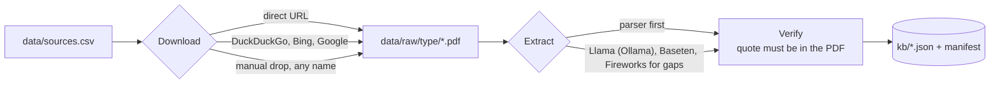

## Repository
```
app/          Streamlit UI · components · UI strings · locales/ (translated interfaces)
core/         pipeline · llm router · agents · translate · tools/ (checks, payout) · verifier · parsers · evidence · appeal · export · snapshots
kb/           jurisdictions/ · seed/ (shipped rules) · policies/ · doc_checklists · built KB files (after build-kb)
data/         sources.csv · demo policies · scenarios/ (24 verified + 12 challenge) · snapshots/ · samples/edge_cases/
scripts/      build_kb.py · make_scenarios.py · doctor.py · demo.py
eval/         run_eval.py
tests/        157 tests
docs/         TESTING.md · DEMO.md · PUBLISH.md · screenshots/
```

## Privacy and limits
- Personal identifiers are masked before any model call. Uploads are processed in memory, and letters are filled locally.
- Rules marked *seed* are paraphrased until `build-kb` replaces them with verbatim quotes; illustrative precedents are never cited in letters.
- Decision support, not legal or medical advice.

MIT licensed · Built for the Meta Muse Spark Hackathon.
